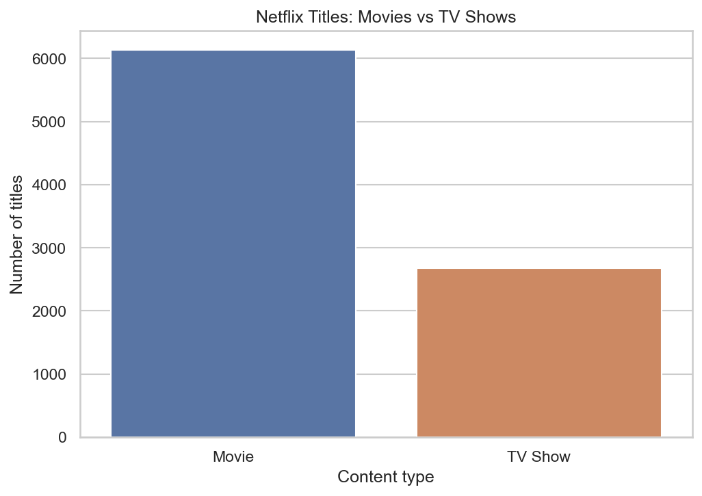
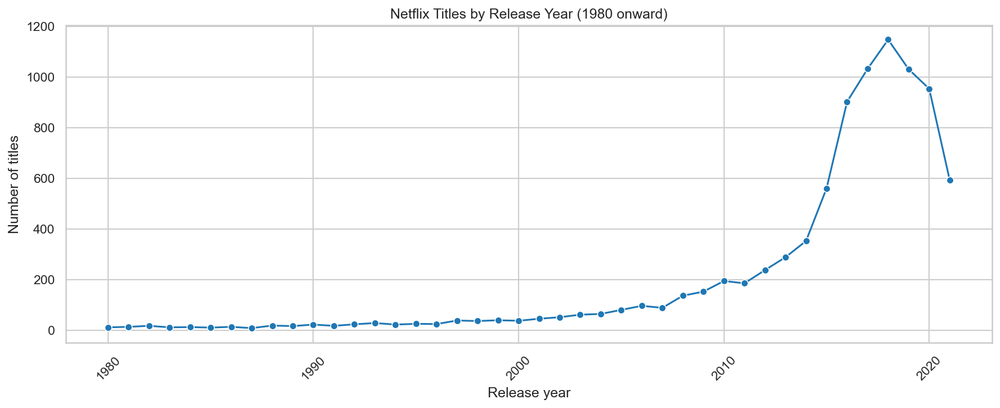
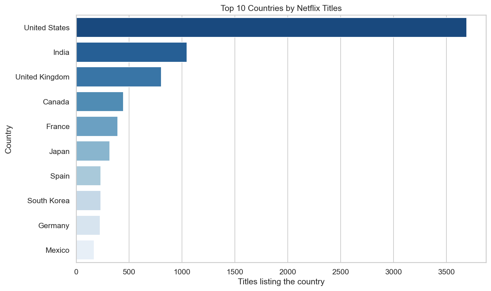
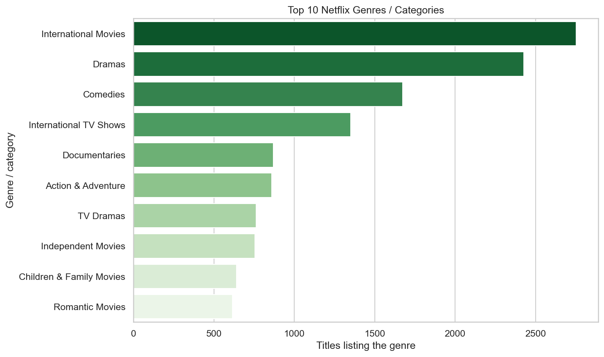
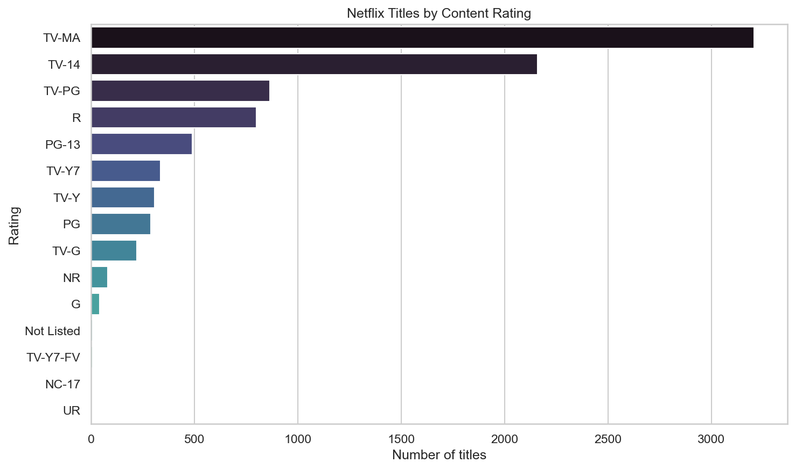
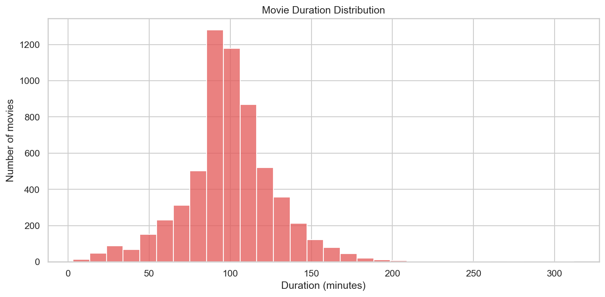
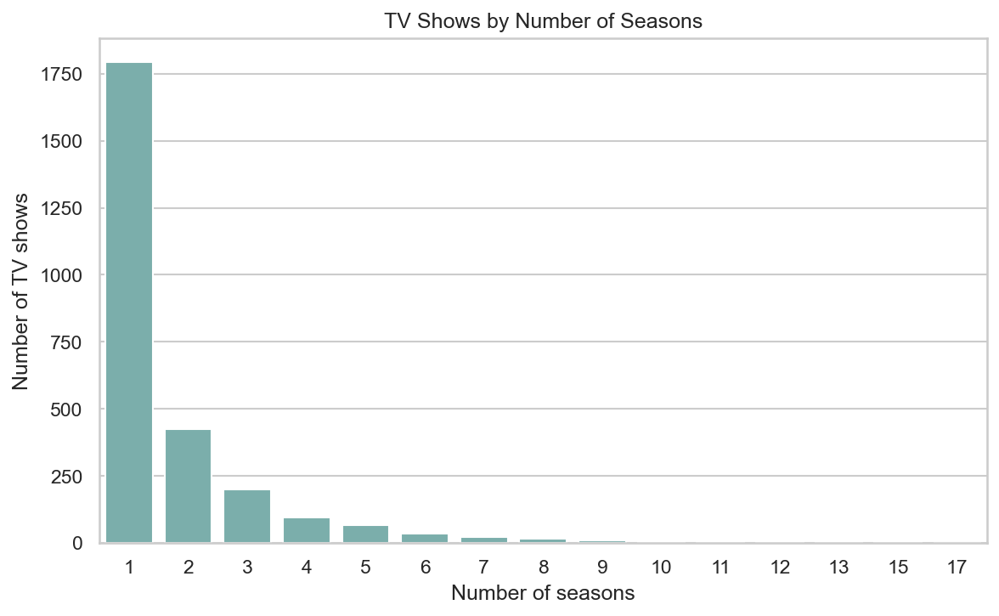
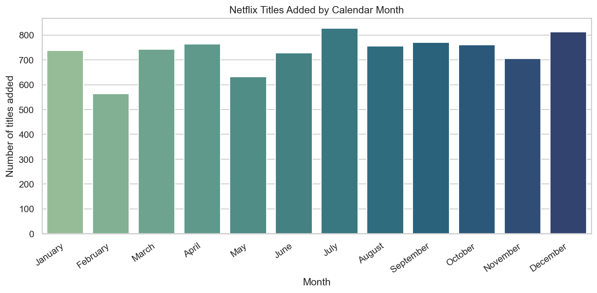
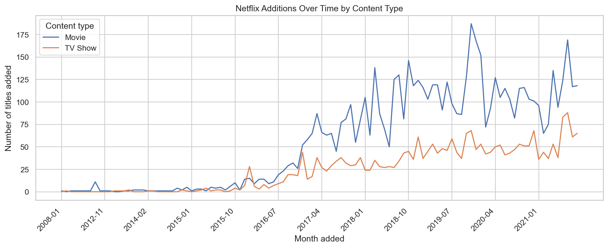

# Netflix Movies & TV Shows Data Analysis

A beginner-friendly exploratory data analysis project using Python, pandas, NumPy, Matplotlib, and Seaborn. The Jupyter Notebook loads the Netflix Movies and TV Shows dataset, documents its cleaning decisions, answers practical analysis questions, and saves nine charts.

## Project objectives

- Compare the Movies and TV Shows in the dataset.
- Explore titles by release year and date added to Netflix.
- Find frequently listed countries, genres, ratings, directors, and actors.
- Summarize movie runtimes and TV show seasons.
- Practice a reproducible data-analysis workflow and communicate its limitations.

## Dataset

The source is [Netflix Movies and TV Shows on Kaggle](https://www.kaggle.com/datasets/shivamb/netflix-shows). Download `netflix_titles.csv` from the dataset page and put it in `data/netflix_titles.csv`.

The CSV is excluded from Git. Check the dataset page's current license and terms before redistributing it; this repository does not include or upload the data file.

## Technologies

- Python
- pandas
- NumPy
- Matplotlib
- Seaborn
- Jupyter Notebook / IPython kernel

## Project structure

```text
netflix-data-analysis/
├── data/
│   └── netflix_titles.csv       # Download separately; ignored by Git
├── outputs/
│   └── charts/                  # PNG charts generated by the notebook
├── netflix_analysis.ipynb       # Complete, documented analysis
├── requirements.txt
├── README.md
└── .gitignore
```

## Data cleaning

The notebook preserves the loaded source as `raw_df` and performs analysis on a separate `cleaned_df`.

- Checks exact duplicate rows and duplicate `show_id` identifiers before removing any.
- Fills missing director, cast, country, rating, and genre/category text with `Not Listed`, rather than dropping those titles.
- Reclassifies duration-like values in the rating column as `Not Listed` in the cleaned copy; the raw values remain available in `raw_df`.
- Parses mixed `date_added` text formats into datetimes. Missing or invalid dates remain missing and are excluded from date-based summaries.
- Extracts the date-added year and month.
- Keeps the original `duration` text and creates separate numeric fields for movie minutes and TV show seasons. Missing or unparseable durations remain missing; the notebook does not guess values.
- Splits comma-separated countries and genres into individual entries for ranking. Titles with multiple entries can count in more than one category.

## Exploratory analysis

The notebook answers:

1. How many Movies and TV Shows are listed, and which type is more common?
2. How are titles distributed by release year?
3. Which countries and genres are listed most often?
4. Which content ratings are most common?
5. What are the average and median movie runtimes?
6. Which TV show season count is most common?
7. Which directors and actors have the most listed credits?
8. Which months have the most recorded additions, and how do additions vary over time by content type?

## Visualizations

Charts are generated in `outputs/charts/` when the notebook is run.

### Movies vs TV Shows


### Titles by release year


### Top countries


### Top genres and categories


### Content ratings


### Movie durations


### TV show seasons


### Additions by calendar month


### Additions over time by content type


## Key findings from this dataset

These figures were produced by running the notebook against the supplied CSV (8,807 rows, 12 columns). They describe this dataset snapshot, not Netflix's current catalog.

- There are **6,131 Movies** and **2,676 TV Shows**; Movies represent **69.6%** of the listed titles.
- **2018** is the most represented release year, with **1,147 titles**. Release year describes when content was released, not when it was added to Netflix.
- The **United States** is the most frequently listed country (**3,690 title-country entries**), followed by India (**1,046**) and the United Kingdom (**806**).
- **International Movies** is the most frequent listed category (**2,752 titles**), followed by Dramas (**2,427**) and Comedies (**1,674**).
- **TV-MA** is the most common rating (**3,207 titles**), followed by TV-14 (**2,160**).
- Three duration-like source values in the rating column were treated as unlisted ratings in the cleaned copy; the raw source remains unchanged.
- Among the **6,128 movies with a parsed runtime**, the average duration is **99.6 minutes** and the median is **98 minutes**.
- **One season** is the most common TV-show length (**1,793 shows**).
- **July** has the most recorded additions by calendar month (**827**), considering the **8,797 titles with a parsed `date_added`**. This pools dates from different years.
- **Rajiv Chilaka** has the most listed director credits (**22 titles**); **Anupam Kher** has the most listed cast credits (**43 titles**).
- No exact duplicate rows or repeated `show_id` values were found, so no records were removed in this dataset run.

Country and genre counts are not mutually exclusive because a title can have several listed values. Director and actor counts are credits in this dataset, not measures of popularity or complete career histories.

## Installation

Run these commands from a terminal:

```bash
cd netflix-data-analysis
python3 -m venv .venv
source .venv/bin/activate
python -m pip install --upgrade pip
pip install -r requirements.txt
```

On Windows, activate the environment with:

```powershell
.venv\Scripts\Activate.ps1
```

## Run the notebook

1. Download `netflix_titles.csv` from Kaggle and place it at `data/netflix_titles.csv`.
2. Open the `netflix-data-analysis` folder in VS Code.
3. Open `netflix_analysis.ipynb` and select the `.venv` Python kernel if prompted.
4. Choose **Run All**. The cells execute in order and save the PNG charts under `outputs/charts/`.

Alternatively, execute the notebook from that folder in a terminal:

```bash
jupyter nbconvert --to notebook --execute --inplace netflix_analysis.ipynb
```

## Limitations

- The dataset is a dated snapshot and is not a live Netflix catalog.
- Some fields are missing; missing dates cannot contribute to date-based analyses.
- A title may list multiple countries, genres, directors, or cast members, so those counts can overlap.
- Release year, addition dates, ratings, and season counts do not measure viewing popularity, quality, or audience engagement.
- This file does not provide complete episode-level or viewership data.

## Future improvements

- Add automated tests for the parsing and cleaning steps.
- Compare ratings and genres between Movies and TV Shows.
- Explore additions over time by country or category, while documenting missing data.
- Add episode-level or viewership analysis only with a suitable, properly licensed dataset.
